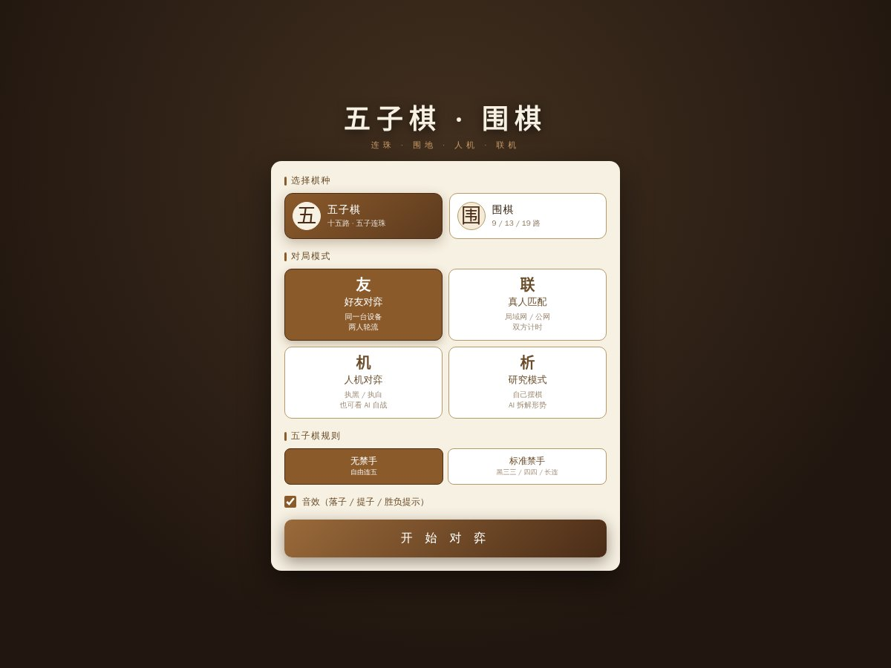
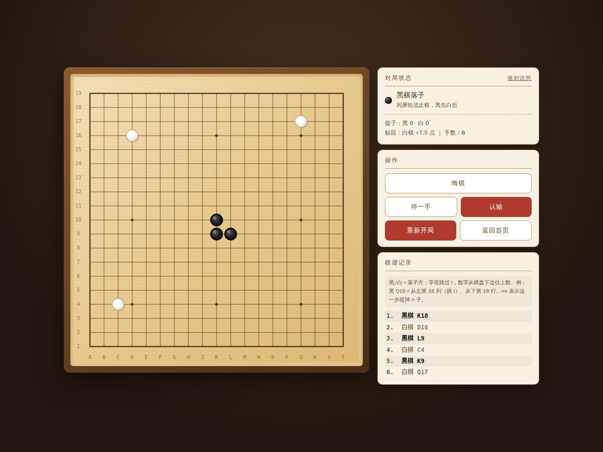
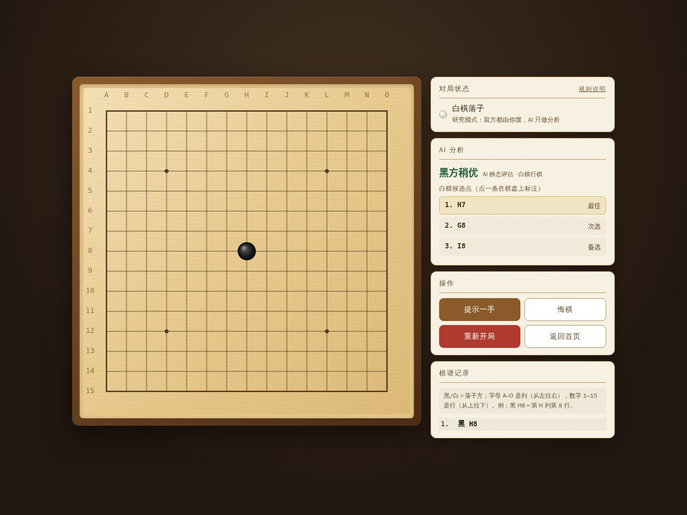

# 五子棋 · 围棋

一个不需要构建工具、不需要依赖的网页棋类游戏：**五子棋 + 围棋**，同一个 HTML 里切换；自带 AI、音效、研究模式和局域网 / 公网双人联机服务端。附带 Windows、Linux、Android 三种打包方式。



## 功能

- **两种棋**
  - 五子棋：15 路，五子连珠；可选无禁手 / 标准禁手（黑三三、四四、长连）。
  - 围棋：9 / 13 / 19 路，中国规则数子，黑贴 3¾ 子（7.5 点）；打劫、禁着、停一手两次终局、标记死子后确认数子。
- **四种模式**：好友同屏、真人匹配、人机对弈（4 档强度，可执黑/执白/观战）、研究模式（每步 3 个候选点 + 形势估算）。
- **联机**：零依赖 Node 服务端；双方都进入对局后才允许落子；支持悔棋请求、认输、掉线判定、继续匹配。
- **界面**：Canvas 棋盘、木纹配色、坐标与星位、落子动画、五连高亮、移动端自适应、WebAudio 音效。
- **工程**：单文件 HTML，无任何第三方前端依赖；AI 跑在 Web Worker 里，WebView `file://` 下自动降级到主线程。



## 快速开始

**单机**：直接用浏览器打开 `五子棋围棋.html`。

**联机**（需要 Node.js）：

```bash
node server.js          # 默认 8080
node server.js 9000     # 换端口
```

启动后终端会打印本机、局域网地址和管理后台：

- 游戏：`http://localhost:8080`
- 管理后台：`http://localhost:8080/admin`，默认密码 `admin888`（可用环境变量 `ADMIN_PWD` 修改）

双方打开同一个地址 → 选「真人匹配」→ 都点「进入对局」→ 开始。

> 跨网络联机需要服务端有公网地址：路由器端口映射、内网穿透（cpolar / frp / Cloudflare Tunnel），或直接部署到云主机。

## 目录结构

```
五子棋围棋.html          游戏本体（HTML + CSS + JS + 两套 AI Worker 全部内联）
server.js                联机服务端（Node 原生 http，无第三方包）
docs/screenshots/          README 截图
README.md  LICENSE  .gitignore
CONTRIBUTING.md          贡献说明
CHANGELOG.md             版本记录
开源发布指南.md           推到 GitHub 的完整步骤
```

Windows 整包、Linux 整包和 Android APK 属于构建产物，不进仓库，统一放在 **GitHub Releases** 供下载。

## 联机协议（server.js）

服务端只负责房间、匹配和消息转发，规则判定全在客户端。

| 接口 | 方法 | 说明 |
|---|---|---|
| `/api/join` | POST | `{name, game, size, rule}` → `{token}`，按 `game|size|rule` 分桶匹配 |
| `/api/poll` | GET | `?token=&after=` 拉取增量事件（matched / move / undoReq / resign / opponent_left …） |
| `/api/ready` | POST | `{token}` 标记自己已进入对局；广播 `oppReady` / `bothReady` |
| `/api/move` | POST | `{token, x, y, pass}`；未双方就位时返回 `not-ready` |
| `/api/sig` | POST | `{token, t, n}`，`t` 为 `undoReq / undoAcc / undoRej / resign` |
| `/api/leave` | POST | 离开房间或匹配队列 |
| `/api/admin/state` | GET | 管理后台数据（需密码） |
| `/api/admin/kick` | POST | 强制解散房间 |

匹配成功时服务端随机分配黑白；`/api/move` 会校验坐标边界和 `pass`，并把落子转发给对手。

## 安卓打包

仓库不提交签名密钥和构建产物。手工构建流程（无 Gradle）：

```
aapt2 compile --dir res -o res.zip
aapt2 link -o base.apk -I android.jar --manifest AndroidManifest.xml -R res.zip -A assets
javac -source 8 -target 8 -bootclasspath android.jar -d classes src/.../MainActivity.java
d8 --lib android.jar --min-api 21 --output . classes/.../MainActivity.class
# 追加 classes.dex 到 APK → zipalign -f 4 → apksigner sign
```

`assets/index.html` 放游戏本体；WebView 需要开启 JS、DOM Storage、file 跨域访问；`file://` 下 Worker 可能被拦，游戏内已做降级。

## 研究模式



五子棋 AI 用棋型评分 + 迭代加深 alpha-beta；围棋 AI 用气、提子、连接、地形和眼位的启发式评分。强度越高思考越久（约 0.1–1.6 秒），不是职业棋力，适合休闲和拆棋。

## License

MIT，见 [LICENSE](LICENSE)。
